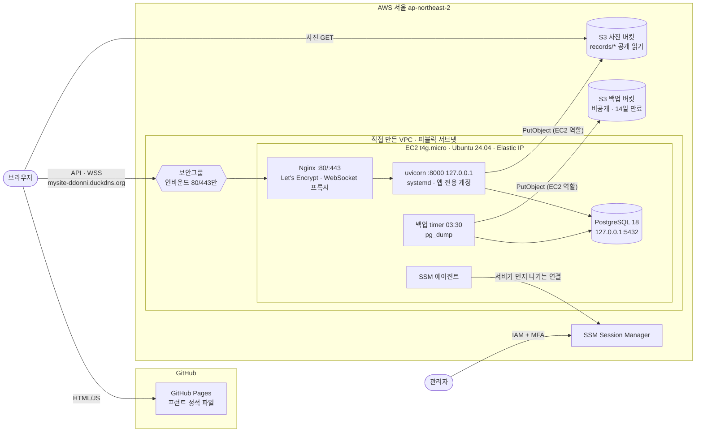

# mysite-infra

mysite 백엔드(FastAPI + PostgreSQL + WebSocket)를 Render 무료 플랜에서 AWS의 직접 운영하는 리눅스 서버로 옮기는 프로젝트.

**2026-10-18 전환 완료. 실제 사용자가 쓰는 서비스를 EC2 한 대에서 직접 운영하고 있다.**

## 한눈에 보기

- **무엇을 했나**: 관리형 PaaS(Render)와 관리형 DB(Neon)에서 돌던 앱을, 직접 만든 VPC 안의 EC2 한 대로 옮겼다. 리눅스 보안 세팅, PostgreSQL, systemd, Nginx(WebSocket 포함), HTTPS, 백업까지 직접 구성했다.
- **전환**: 절차서([CUTOVER.md](CUTOVER.md))를 먼저 쓰고, 롤백 계획을 세운 뒤 전환했다. 최종 덤프와 서버 DB의 행 수가 일치하는 것을 확인했다.
- **운영**: 자동 보안 업데이트와 재부팅(다운타임 약 19초), 매일 백업 + 복구 훈련(RPO 24시간, DB 복원 0.8초), 앱이 죽으면 3초 안에 자동으로 다시 뜬다.
- **장애 실험**: 앱 강제 종료, DB 중지, 디스크 100%를 일부러 일으켰다. 예측과 결과를 비교하고, 그 과정에서 숨어 있던 문제 두 개를 찾아 고쳤다.
- **트러블슈팅 12건**: [TROUBLESHOOTING.md](TROUBLESHOOTING.md). 특히 아래 세 건.
  - **#7 비밀번호 노출 → 교체**: 교체한 뒤 예전 비밀번호가 실제로 거절되는 것까지 확인했다.
  - **#10 "가끔 나는 500"**: 원인은 새벽 자동 업데이트가 DB를 재시작한 것이었다. 고치기 전 버전으로 되돌려 같은 조건에서 500이 나는 것까지 보여 주는 대조 실험으로 검증했다.
  - **#12 디스크 100%**: 같은 500인데 이번에는 앱이 아니라 Nginx가 냈다. 응답 크기와 로그를 근거로 출처를 갈랐다.
- **비용**: 월 약 $12 + VAT(추정). 이 중 퍼블릭 IPv4 요금이 $3.65로 서버 요금의 절반 가까이 된다.

| 문서 | 내용 |
|---|---|
| [ROADMAP.md](ROADMAP.md) | 단계별 체크리스트와 완료 확인 |
| [MEASUREMENTS.md](MEASUREMENTS.md) | 이사 전후 측정, 메모리·디스크, 백업·복구, 비용 |
| [TROUBLESHOOTING.md](TROUBLESHOOTING.md) | 증상 → 원인 추측 → 확인한 것 → 진짜 원인 → 해결 → 배운 점 |
| [CUTOVER.md](CUTOVER.md) | 전환 절차서, 롤백 A/B, 실행 기록 |

## 구성도

- 인바운드로 열린 포트는 80/443뿐이다. SSH(22), uvicorn(8000), PostgreSQL(5432)은 밖에서 닿지 않는다.
- 서버에는 AWS 액세스 키가 없다. 앱과 백업 모두 EC2 역할의 임시 자격 증명으로 S3에 쓴다.

## 선택 근거

### 계정 접근: IAM 사용자 + Admin 그룹 + MFA (1-1)

- **IAM Identity Center 대신 IAM 사용자**: Identity Center는 여러 AWS 계정에 한 번 로그인(SSO)하고 임시 자격 증명을 발급해 주는 서비스다. 계정 하나, 사용자 하나인 개인 프로젝트에서는 그 이점이 거의 없고 Organizations 설정까지 필요해서 IAM 사용자를 골랐다. 대신 IAM 사용자는 오래 쓰는 비밀번호를 갖게 되므로, 그 단점은 MFA로 보완한다.
- **사람과 기계의 권한 분리**: `AdministratorAccess`는 콘솔에서 인프라를 직접 만드는 **사람(나)** 에게만 준다. 이 사용자는 콘솔 전용이라 액세스 키를 만들지 않는다. 서버(EC2)나 배포(GitHub Actions) 같은 **기계**에는 장기 액세스 키를 쓰지 않고, 필요한 권한만 담은 IAM 역할을 준다(EC2 인스턴스 프로파일, GitHub OIDC). 최소 권한 원칙은 이 기계용 권한에 적용한다.
- **넓은 권한을 지키는 장치**:
  - 예방: 루트와 IAM 사용자 모두 MFA / IAM 사용자에 액세스 키 없음 / 루트는 일상적으로 쓰지 않고 루트 액세스 키도 없음 / 공용 PC(학원)에는 키를 저장하지 않고 쓰고 나면 로그아웃
  - 탐지: 예산 알림. 예방 장치가 뚫려도 비정상적인 청구액으로 알아챌 수 있다.

### 네트워크: 직접 만든 VPC + 퍼블릭 서브넷 하나 (1-2)

요청이 들어오는 길: **인터넷 → IGW(VPC의 출입문) → 라우팅 테이블(서브넷에 연결, "밖은 IGW로") → 서브넷(AZ 하나) → 보안그룹(서버에 붙은 방화벽) → EC2**

- **기본 VPC 대신 직접 구성**: 각 부품이 무슨 역할을 하는지 손으로 만들어 보면서 이해하려고. 2단계에서 Terraform으로 코드화한다.
- **"퍼블릭"은 라우팅 테이블 한 줄로 정해진다**: 서브넷에 "퍼블릭" 옵션은 없다. 연결된 라우팅 테이블에 `0.0.0.0/0 → IGW`가 있으면 퍼블릭이다. 누가 들어올 수 있는지는 서브넷이 아니라 보안그룹이 정한다.
- **메인 라우팅 테이블은 비워 두고, 퍼블릭용 테이블을 따로 만들어 명시적으로 연결**: 메인 테이블에는 `local`만 있다. 나중에 서브넷을 만들고 연결을 깜빡해도 기본값이 프라이빗이라 실수로 인터넷에 노출되지 않는다(안전한 기본값). 퍼블릭/프라이빗 경계도 분명해진다.
- **기본 보안그룹은 쓰지 않고 웹 서버용 보안그룹을 새로 만듦**: 기본 그룹은 리소스를 만들 때 자동으로 선택되기 쉬워서, 거기에 포트를 열면 의도치 않은 리소스까지 열린다.
- **인바운드는 80/443만**:
  - 22(SSH)는 열지 않고 **SSM Session Manager**로 접속한다. 22번을 인터넷에 열면 봇이 계속 비밀번호를 대입해 본다. "내 IP만 허용"은 집과 학원의 IP가 달라서 관리하기 번거롭다. SSM은 열린 포트 없이 IAM + MFA로 인증하고, 접속 기록이 CloudTrail에 남는다.
  - 8000(uvicorn)도 열지 않는다. Nginx가 80/443을 받아서 서버 안에서 넘겨 준다.
- **아웃바운드는 전체 허용(기본값) 유지, 트레이드오프를 알고 선택**:
  - 보안그룹은 stateful이라 들어온 요청의 응답은 아웃바운드 규칙과 상관없이 나간다. 아웃바운드 규칙이 막는 건 서버가 먼저 거는 연결뿐이다.
  - 서버는 apt, pip, S3, Neon(`pg_dump`), Let's Encrypt 등으로 밖에 나가야 하고, 이 목적지들의 IP는 계속 바뀌어서 IP로 막는 건 관리 비용이 크다.
  - 대가: 서버가 털리면 데이터가 밖으로 나갈 수 있다. 진짜 방어선은 인바운드 최소화, SSM, IAM 역할(최소 권한) 쪽에 둔다.
  - 나중에 해 볼 것: 목적지는 전체로 두고 포트만 80/443(+DB 포트)으로 좁히기
- **NAT 게이트웨이 없음**: 켜 두기만 해도 월 수만 원이 나간다. 프라이빗 서브넷이 아직 필요 없어서 만들지 않았다.

### 서버: EC2 `t4g.micro` + SSM 접속 (1-3)

- **ARM(`t4g`)**: 같은 급의 x86(`t3`)보다 싸다. 앱은 Docker 없이 venv로 돌리고, C 확장 패키지인 `psycopg2-binary`도 Python 3.12 + Linux `aarch64`용 wheel이 있어서 ARM에서 문제가 없다.
- **`micro`(1GB) + 스왑**: PostgreSQL + uvicorn 워커 1개 + Nginx를 합쳐 평소 약 500~650MB로 추정했다(데이터는 약 8MB). 설치·복원·백업처럼 순간적으로 메모리가 튈 때 OOM killer가 DB를 죽이지 않도록 스왑을 둔다. 실제 사용량을 재 보고 모자라면 중지 → 타입 변경으로 올린다.
- **키 페어 없음, SSM Session Manager로 접속**: 22번을 열 필요가 없다. SSM 에이전트가 서버에서 AWS로 **먼저 나가서** 연결을 맺기 때문에 인바운드 포트가 필요 없고, 대신 서버가 밖으로 나갈 수 있도록 퍼블릭 IP가 있어야 한다. 대가로, 에이전트가 고장 나면 비상 접속 수단이 없다(디스크를 떼서 다른 서버에 붙여 고쳐야 함).
- **EC2 역할(`ec2.amazonaws.com`이 맡음)에는 지금 `AmazonSSMManagedInstanceCore`만 붙임**: S3 권한은 앱을 올리는 1-6에서, 버킷 하나로 범위를 좁혀 **같은 역할에** 추가한다. 쓰지 않는 권한은 미리 주지 않고, 버킷도 서울로 옮길 수 있어서 확정된 뒤에 쓴다. 서버에는 액세스 키를 두지 않는다. boto3가 역할의 임시 자격 증명을 메타데이터에서 자동으로 가져온다.
- **IMDSv2만 허용**: 메타데이터(`169.254.169.254`)는 역할의 임시 자격 증명을 내준다. v1은 GET 한 번에 답해서 SSRF(앱을 속여 대신 요청하게 하는 공격)로 자격 증명이 새어 나갈 수 있다. v2는 PUT으로 토큰을 받고 헤더에 넣어야 해서 대부분의 SSRF를 막는다. 토큰 없이 요청하면 401, 토큰을 넣으면 인스턴스 ID가 나오는 걸 직접 확인했다.
- **디스크 8GB(기본값)**: 일부러 작게 두고, 1-11에서 가득 차는 상황과 무중단 확장(볼륨 수정 → 파티션·파일 시스템 확장)을 연습한다.

### 리눅스 기본 세팅 (1-4)

- **sshd를 끔**: 키 페어 없이 SSM으로만 접속하니 sshd는 쓰이지 않는 서비스다. 보안그룹이 22번을 막고 있어도 서버 쪽에서도 22번을 아무도 듣지 않게 해서 두 겹으로 막는다(심층 방어). Ubuntu 24.04는 socket activation 방식이라 `ssh.socket`이 22번을 듣고 있다가 접속이 오면 `ssh.service`를 깨운다. 그래서 둘 다 disable했다. 패키지는 지우지 않아서 필요하면 SSM으로 들어가 다시 켤 수 있다.
- **작업용 사용자**: SSM이 만든 `ssm-user`(sudo 가능)가 그 역할을 한다. 앱은 1-6에서 로그인할 수 없는 전용 사용자로 실행한다.
- **ufw**: 들어오는 건 기본 차단, 나가는 건 허용, 80/443만 연다. SSM은 서버가 밖으로 나가는 연결이라 22번을 열지 않아도 끊기지 않는다. 보안그룹과 겹치게 두는 이유: 보안그룹을 실수로 넓게 열어도 서버가 한 번 더 막고, 1-5의 PostgreSQL(5432)처럼 내부에서만 쓸 포트도 두 겹으로 막힌다.
- **자동 보안 업데이트 + 자동 재부팅 04:00(KST)**: Ubuntu 24.04는 `unattended-upgrades`가 기본으로 켜져 있어서 확인만 했다(`20auto-upgrades`의 `"1"` = 1일마다, 실제 실행은 `apt-daily*.timer`). 커널 패치는 재부팅해야 적용되는데, 사용자가 적어 새벽 1~2분 중단은 감수할 수 있어서 자동 재부팅을 켰다. 업데이트는 아침 6시쯤 돌기 때문에 다음 날 새벽에 적용된다. 원본(`50unattended-upgrades`)은 건드리지 않고 `52unattended-upgrades-local`로 덮어썼다. 패키지 업데이트 때 설정 파일 충돌을 피하려는 것이다. 적용 여부는 `apt-config dump`로 확인했다.
- **시간대 Asia/Seoul**: 로그 시각을 읽기 쉽게 하고, 재부팅 시각처럼 시간을 적는 설정이 한국 시간 기준이 되게 하려고. UTC 그대로였다면 "04:00"이 한국 시간 오후 1시가 됐다.
- **스왑 1GB(`/swapfile`), swappiness 10**: RAM이 1GB라 설치·복원·백업처럼 순간적으로 메모리가 튈 때 OOM killer가 DB를 죽이지 않게 하는 완충재다. 실제 쓸 수 있는 디스크가 6.8G밖에 안 되고(남은 공간 4.8G), 스왑을 많이 쓰는 상태 자체가 느려서 못 쓰는 상태라 1GB로 잡았다. swappiness를 기본 60에서 10으로 내려서 평소에는 RAM만 쓰고 위급할 때만 스왑을 쓰게 했다. 스왑에는 메모리 내용(비밀번호 등)이 그대로 내려가므로 권한은 600이다.

### DB: 서버 안의 PostgreSQL 18 (1-5)

- **버전 18, PostgreSQL 공식 저장소(PGDG)에서 설치**: Neon이 18이다. `pg_dump`는 자기 버전 이하의 서버만 덤프할 수 있고, 새 버전의 덤프를 옛 버전에 복원하는 건 보장되지 않는다. 그래서 버전을 맞췄다. Ubuntu 24.04 기본 저장소에는 16까지만 있어서 PGDG 저장소를 서명 키와 함께 추가했다.
- **앱 전용 롤 `mysite`, 슈퍼유저 아님**: 슈퍼유저는 모든 권한 검사를 건너뛰고, `COPY ... FROM PROGRAM`으로 서버에서 리눅스 명령까지 실행할 수 있다. 앱이 슈퍼유저면 SQL 인젝션 하나가 곧 서버 장악이 된다. 앱 롤은 로그인만 가능하고, DB `mysite`의 **소유자**로 지정해서 Alembic이 자기 DB 안에서 테이블을 만들고 바꿀 수 있게 했다(PostgreSQL 15부터 `public` 스키마는 DB 소유자가 쓸 수 있다). 나중에 마이그레이션용 롤과 실행용 롤을 나누는 것도 고려할 수 있다.
- **비밀번호는 `\password`로 설정**: `CREATE ROLE ... PASSWORD '...'`는 psql 기록 파일에 평문으로 남는다. `\password`는 프롬프트로 받아 해시해서 보낸다.
- **5432번은 네 겹으로 막는다**: 보안그룹(80/443만), ufw(80/443만), `listen_addresses = 'localhost'`(Ubuntu 기본값, `127.0.0.1:5432`에서만 들음), `pg_hba.conf`(127.0.0.1에서 온 TCP 접속만 `scram-sha-256` 비밀번호로 인증). 앱과 DB가 같은 서버에 있어서 외부에 열 이유가 없다.
- **인증 경로 두 가지**: `local` + `peer`는 소켓 파일로 접속하면서 리눅스 사용자 이름과 DB 롤 이름이 같을 때 통과한다(관리자는 `sudo -u postgres psql`). 앱은 `-h 127.0.0.1`(TCP) + 비밀번호로 접속한다. `ssm-user`가 `-h` 없이 `mysite`로 접속하면 peer 인증에서 거절된다.

### 앱 실행: systemd + 로그인할 수 없는 전용 계정 (1-6)

- **코드와 venv는 root 소유, 앱은 `mysite` 계정(nologin)으로 실행**: 인터넷 입력을 직접 처리하는 계정이 가장 먼저 털린다. 그래서 그 계정은 코드를 고칠 수 없게 했다. 털려도 백도어를 심을 수 없다. 앱은 디스크에 쓸 일이 없다(사진은 S3, 로그는 journald).
- **환경변수는 `/etc/mysite/backend.env`(root, 600)**: systemd가 root로 읽어서 넣어 준 뒤 `mysite` 계정으로 앱을 실행한다. 그래서 앱 계정 자신도 파일을 읽을 수 없다. AWS 키는 넣지 않는다.
- **systemd 하드닝**: `NoNewPrivileges`, `ProtectSystem=strict`(시스템 전체 읽기 전용), `ProtectHome`, `PrivateTmp`. 이 중 `ProtectHome`이 libpq의 SSL 기본 동작과 부딪쳐서, 새 DB 연결마다 SSL 시도가 실패하고 있었다. 1-11 장애 실험에서 발견해 `sslmode=disable`로 고쳤다(#11). 같은 서버 안의 연결이라 암호화할 대상이 없다.
- **`Restart=always`**: `kill -9`를 해도 3초 안에 새 프로세스로 뜬다. 대신 계속 죽는 앱도 겉으로는 살아 있는 것처럼 보인다. 그래서 `restart counter`를 함께 본다(#8).
- **Docker 대신 venv + systemd**: 1단계 목표가 리눅스 서비스 운영 자체를 익히는 것이라서, 프로세스·계정·권한·로그를 OS 수준에서 직접 다뤘다. 컨테이너는 3단계(k3s)에서 다룬다.

### 사진 저장: 이 계정 서울 리전에 새 버킷 + EC2 역할 (1-6)

- 예전 버킷은 **어느 계정 것인지 확인되지 않는 다른 AWS 계정**에, 그것도 실수로 시드니에 있었다. 교차 계정으로 권한을 맞추는 대신, 이 계정 서울 리전에 새로 만들었다. 모든 리소스가 한 계정에 모이고, 장기 키가 필요 없어진다.
- 앱 코드가 하는 일은 `put_object` 하나뿐이고, 키는 항상 `records/<uuid>`다. 그래서 역할에는 **`s3:PutObject` on `records/*`만** 줬다. 버킷 맨 위에 쓰기를 시도하면 `AccessDenied`가 나는 것으로 범위를 확인했다.
- 버킷 정책으로 `records/*`만 공개 읽기를 허용했다. ACL로 공개하는 길은 막았다. 목록 보기(ListBucket)는 주지 않았다.
- 예전 사진은 DB에 전체 URL로 저장돼 있어서 예전 버킷에서 계속 보인다. 새 버킷으로 옮기는 건 병행 운영이 끝난 뒤에 한다.

### Nginx 리버스 프록시 + WebSocket (1-7)

- **WebSocket**: `proxy_http_version 1.1` + `Upgrade`/`Connection` 헤더(`map $http_upgrade`). 3분 넘게 연결을 유지해서 확인했다. 서버와 클라이언트가 20초마다 ping을 보내서 Nginx의 기본 60초 유휴 타임아웃에 걸리지 않는다.
- **`X-Forwarded-For $remote_addr` (덧붙이기가 아니라 덮어쓰기)**: 앱의 방 생성 제한은 이 헤더의 **첫 번째 값**을 방문자 IP로 쓴다. 흔한 예제처럼 `$proxy_add_x_forwarded_for`로 덧붙이면, 방문자가 가짜 값을 보내서 제한을 우회할 수 있다.
- **`client_max_body_size 11m`**: 앱의 업로드 한도(10MB)보다 살짝 크게 했다. 기본값 1MB면 큰 사진이 Nginx에서 413으로 막힌다.

### 도메인·HTTPS: DuckDNS + Let's Encrypt (1-8)

- **무료 서브도메인(DuckDNS)**: 개인 프로젝트라 도메인을 사지 않았다. 대가로 DNS를 남의 무료 서비스에 맡긴다. DuckDNS 토큰은 비밀 값으로 다룬다.
- **Elastic IP**: 도메인이 가리킬 IP가 바뀌면 안 된다. 대가로, 인스턴스를 꺼도 IP 요금이 계속 나간다.
- **certbot `--nginx --redirect`**: HTTP는 HTTPS로 301 리다이렉트한다. 인증서는 90일짜리라 **자동 갱신이 실제로 예약돼 있는지**(`certbot.timer`)와 **갱신이 성공하는지**(`renew --dry-run`)까지 확인했다.

### 전환: 롤백 스위치는 문제가 생길 시스템 바깥에 (1-9)

- 전환 스위치는 프런트 `config.js`의 `API_BASE` 한 줄이다. 롤백도 그 커밋을 revert하면 된다. 롤백 스위치가 GitHub에 있으니, **EC2가 통째로 죽어도 되돌릴 수 있다.** Nginx 설정으로 되돌리는 방식은, 고장 난 서버로 고장을 해결해야 해서 롤백 수단이 될 수 없다.
- **자동 장애 조치는 하지 않았다**: "EC2가 죽으면 자동으로 Render로" 방식을 검토했다. 하지만 Render가 보는 Neon은 전환 시점에 멈춘 데이터라, DB가 두 갈래로 갈라지는 **스플릿 브레인**이 생긴다. DB가 하나인 구성에서는 수동 롤백 + 백업이 더 안전하다.
- 코드와 DB는 같은 시점의 것이어야 한다. 리허설 때 서버 코드가 DB보다 오래돼서 앱이 무한 재시작한 적이 있다(#8). 그래서 전환 절차에 "서버 코드를 운영과 같은 커밋으로 맞춘다"를 넣었다.

### 백업: systemd timer → 비공개 S3, 서버는 지울 수 없음 (1-10)

- 매일 03:30 `pg_dump -Fc`를 실행해서 비공개 버킷에 올린다. `postgres` 계정의 peer 인증을 써서 **비밀번호 파일이 필요 없다.**
- 사진 버킷과 분리했다. 사진 버킷에는 공개 읽기 정책이 있어서, 실수 하나로 DB 덤프가 공개될 수 있다.
- **서버에는 삭제 권한이 없다**(Put/Get만). 오래된 백업은 S3 수명 주기 규칙이 14일 뒤 지운다. 서버가 털려도 공격자가 백업을 지울 수 없다.
- 백업은 복원해 보기 전까지는 백업이 아니다. S3에서 내려받아 새 DB에 복원하고, 행 수가 운영 DB와 같은지 확인했다(0.823초).

### 장애 실험에서 나온 2단계 할 일 (1-11)

| 실험에서 본 것 | 2단계에서 할 일 |
|---|---|
| DB가 죽어도 `/health`는 healthy (#11) | DB까지 확인하는 readiness 체크 |
| 디스크 100%에서 장애 순간의 로그가 사라짐 (#12) | 디스크 사용률 80% 알림 |
| 백업이 실패해도 아무도 모름 | 백업 실패 알림 |
| 서버를 잃으면 재구축에 수 시간 | Terraform으로 인프라 코드화 |

## 월 비용

추정치(서울 리전 정가, 24시간 운영)다. 실제 청구액은 [MEASUREMENTS.md](MEASUREMENTS.md) 2-2에 기록한다.

| 항목 | 월 |
|---|---|
| EC2 `t4g.micro` | 약 $7.6 |
| 퍼블릭 IPv4 (Elastic IP) | $3.65 |
| EBS gp3 8GB | 약 $0.73 |
| S3 (사진·백업 수십 MB) | $0.1 미만 |
| 인터넷 아웃바운드 (월 100GB까지 무료) | $0 |
| **합계** | **약 $12 (+VAT 10%)** |

## 롤백·복구 방법

| 상황 | 방법 | 시간 |
|---|---|---|
| 전환 직후 문제 (새 데이터 거의 없음) | `mysite`에서 전환 커밋을 revert → Pages 배포 (롤백 A) | 수 분 + Render 깨우는 데 약 22초 |
| 전환 후 데이터가 쌓인 뒤 문제 | 먼저 롤백 A로 새 쓰기를 막음 → EC2 DB 덤프 → Neon에 복원 (롤백 B) | 수십 분 |
| 앱 프로세스 죽음 | systemd가 자동으로 다시 띄움 | 3초 이내 |
| DB 데이터 손상·실수로 삭제 | 최신 S3 백업 → `pg_restore` | 1초 미만 (최대 24시간 데이터 손실) |
| 디스크 가득 참 | 원인 파일 삭제 → 서비스는 저절로 회복. 공간이 필요하면 EBS 확장(#12의 절차) | 수 분 |
| 서버·디스크를 통째로 잃음 | 1-3~1-8을 다시 구성 → S3 백업으로 복원 | 수 시간 (→ 2단계 Terraform) |

자세한 순서는 [CUTOVER.md](CUTOVER.md)(롤백 A/B)와 [TROUBLESHOOTING.md](TROUBLESHOOTING.md) #12(EBS 확장)에 있다.
